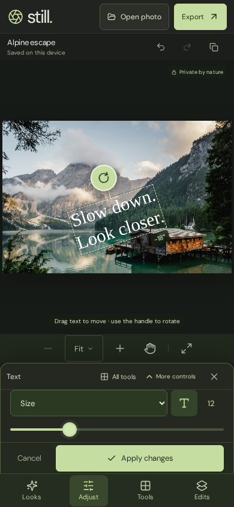
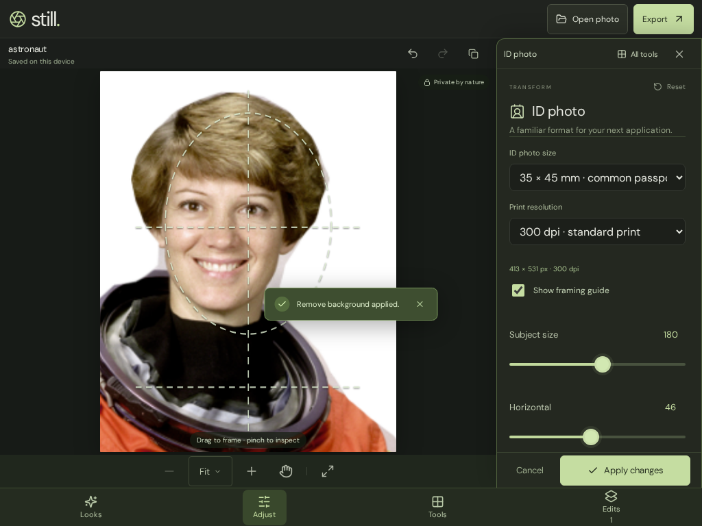
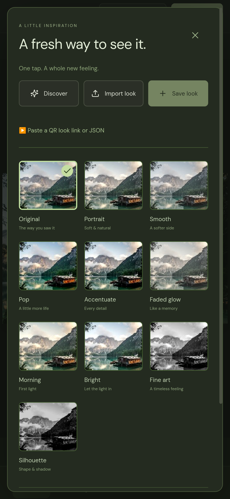
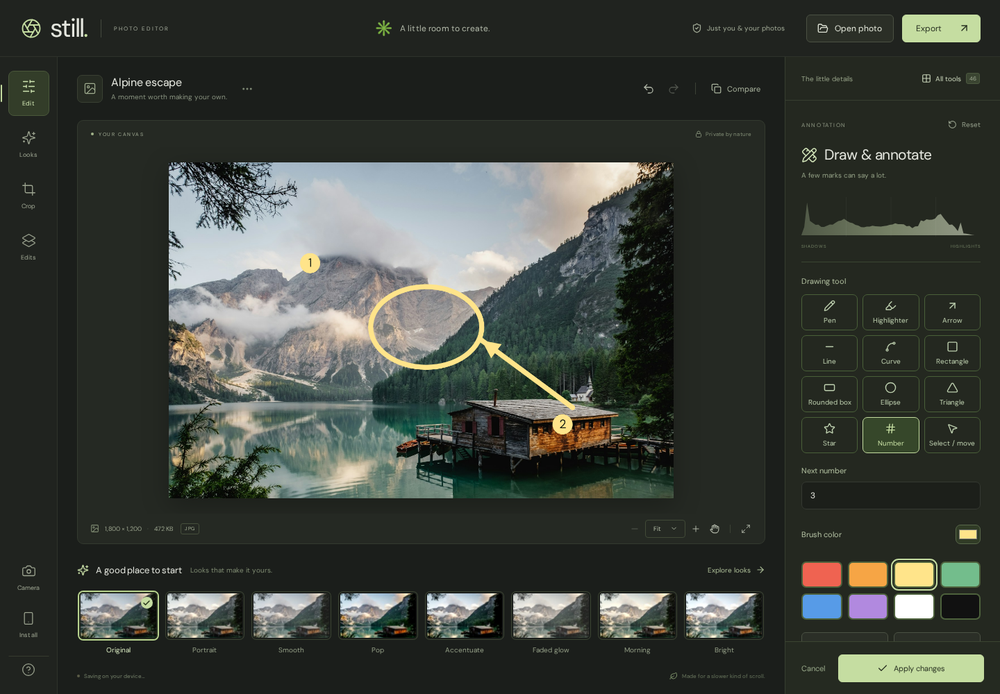
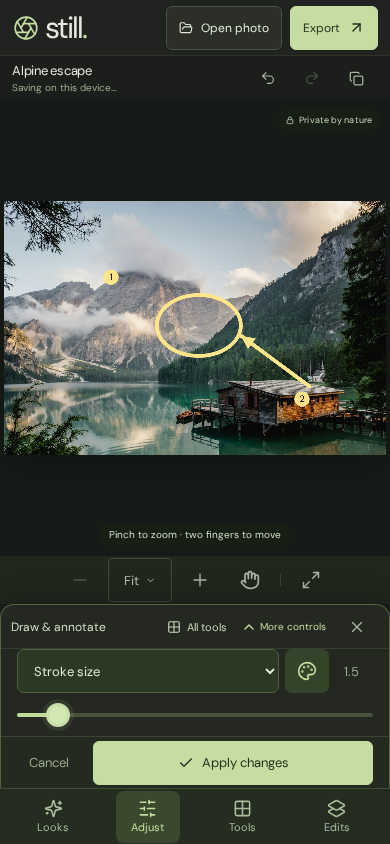
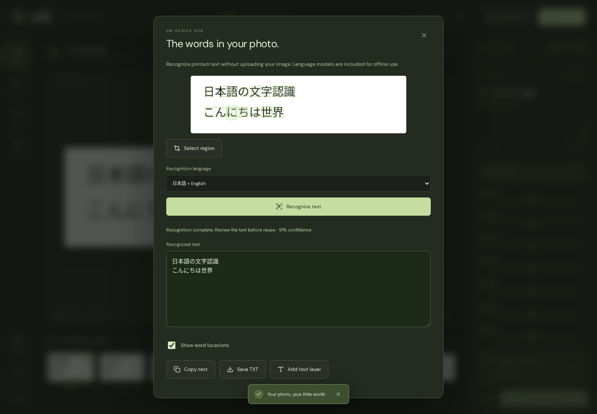
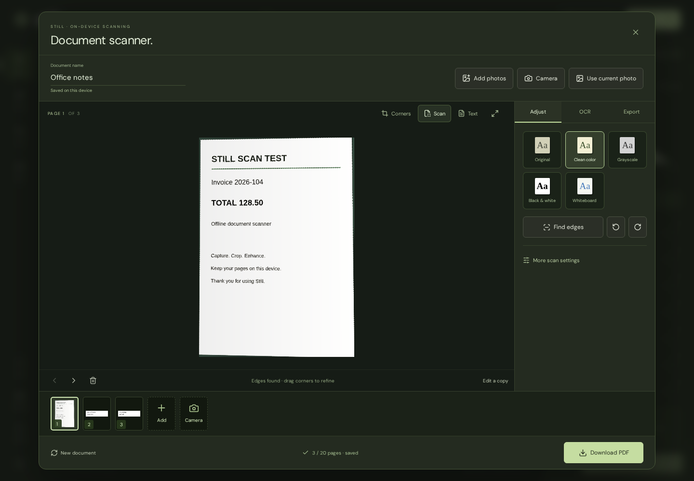
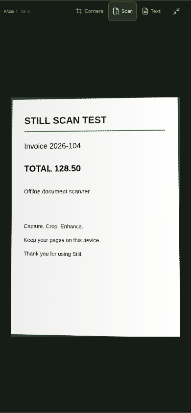
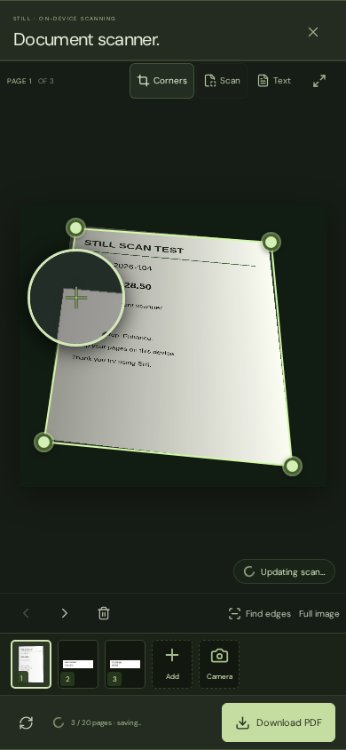

# Validation

Validated in the supplied workspace on November 14, 2026 (Pacific time).

| Check                                | Result                                                                                                                                                                                                                                                                       |
| ------------------------------------ | ---------------------------------------------------------------------------------------------------------------------------------------------------------------------------------------------------------------------------------------------------------------------------- |
| TypeScript and Vite production build | Passed, including worker bundles and checksum-verified model assets                                                                                                                                                                                                          |
| Unit tests                           | 63 passed: color/LUT math, portable Looks/blur, resize/filename math, print density, ID dimensions, metadata, content-aware fill, drawing style/recipe validation, connected/matching/transparent fills and recovery                                                         |
| Community API integration tests      | 11 passed: accounts/session invalidation, ownership, likes/comments, persistence, search, idempotency, CORS, request/body limits and render-data validation                                                                                                                  |
| Chromium browser suite               | 68 passed, covering image editing, drawing/privacy/fill, actual OCR, touchscreen interaction, and the advanced workflows below                                                                                                                                               |
| iPhone WebKit suite                  | 8 passed: every starter Look/thumbnail, skin smoothing fallback, format conversion/resize, ID dimensions/density, finger text rotation, colored annotation/fill/redaction, and real local OCR                                                                                |
| Offline intelligence                 | Networking disabled before reload; actual face landmarks, projected pose, subject selection and learned depth completed successfully                                                                                                                                         |
| Drawing / annotation                 | Six distinct brush tips, immutable per-stroke colors, Brush → Paint color, pen/highlighter erasing, multiply text preservation, eight shape/line tools, fills, move selection, numbering, undo/redo and saved recovery                                                       |
| Privacy / emphasis                   | Local blur lowers selected-region variance; pixelation reduces distinct colors; surrounding pixels stay unchanged; redaction verified in an actual exported PNG; multiple spotlights preserve both clear regions                                                             |
| Bucket fill                          | Connected boundaries, disconnected matching colors, opacity, complete-canvas fill, premultiplied transparent pixels, clearing alpha, undo and saved recovery verified                                                                                                        |
| OCR                                  | Actual English, simplified Chinese and Japanese fixtures recognized with local worker/models; offline reload/TXT/text-layer output, crop/word boxes, cancellation/restart, and scanning the visible redacted image verified                                                  |
| Document scanner                     | Actual skewed page detection and projective correction, no cropping to flat text, touch/keyboard corners and magnifier, cleanup/rotation, multipage order/delete/undo, draft recovery, PDF/PNG/JPG/ZIP/TXT, and full phone preview verified                                  |
| Scanner camera                       | Real deterministic video frames exercise live edge outlines, steady auto capture without duplicates, rear/front/physical lens choices, torch constraints, track cleanup and device-camera fallback                                                                           |
| Searchable PDF                       | Actual English/Chinese OCR after offline reload and Japanese OCR in iPhone WebKit; PDF.js extracts Unicode from downloaded PDFs. PDF page sizes/order, cancel without a partial download, OCR invalidation and redacted editor-copy replacement/undo are verified            |
| Content-aware operations             | Healing changes verified; smart expansion fills new pixels and undo restores the original                                                                                                                                                                                    |
| RAW                                  | Synthetic Bayer DNG decoded as 16-bit linear data; exposure changes pixels; original RAW bytes and edited result survive reload. A real 30.3 MB Sony ARW was also opened locally                                                                                             |
| Camera                               | Deterministic media streams verify front/back constraints, physical lens choice, old-track cleanup, single-camera fallback, mirrored preview/capture and editable Looks                                                                                                      |
| Text rotation / flip / mirror        | Actual touch input rotates text 90° with the on-image handle; export/undo checked; arbitrary slider/recovery and corner-pixel flip/mirror checks also pass                                                                                                                   |
| Format / resize / compression        | Real JPG→PNG conversion, corrected filename extension, custom dimensions, percentage reduction, crop-before-resize geometry, and actual JPG/PNG byte limits verified                                                                                                         |
| ID photos                            | All eight preset pixel sizes verified; 300/600 dpi, drag framing, PNG pHYs and JPEG EXIF density checked on downloaded files; camera tags absent when preservation is off                                                                                                    |
| Collage / stitching                  | Actual grid pixels, both strip directions, unequal source ratios, order changes, removal, source recovery and mobile canvas visibility verified                                                                                                                              |
| Stickers / overlays                  | Built-in vector stickers render offline; imported image transparency preserves underlying pixels; positioning, rotation, independent stack layers and undo verified                                                                                                          |
| Background removal                   | Actual learned cutout after offline reload; transparent/color/photo backgrounds, edge softness, alpha retained through mirroring and actual PNG download, plus saved recovery                                                                                                |
| Skin retouch                         | Detected-face skin smoothing and whitening change image pixels, preserve surrounding pixels, and undo restores the source                                                                                                                                                    |
| Metadata                             | Actual JPG/PNG/WebP downloads retain selected EXIF/GPS with corrected orientation/dimensions; PNG metadata can be read for another editing session                                                                                                                           |
| Presets                              | Still QR, native Tune/Curves QR, unsupported-operator disclosure, XMP round-trip, ZIP packs, Hald and tiled PNG LUTs verified                                                                                                                                                |
| Batch / reusable AI Looks            | Worker analysis observed for every target image; face coordinates change correctly for a differently sized scene rather than reusing the creator's coordinates                                                                                                               |
| Community UI                         | Service connection, account creation, reviewed offline publishing/outbox retry, likes and escaped-text comments verified against the actual local service                                                                                                                    |
| File handling                        | Manifest extensions/scope and simulated initial OS launch passed                                                                                                                                                                                                             |
| Repository subpath                   | Independent `/photo-editor/` build; service-worker scope, actual offline face inference and Chinese OCR passed with no failed requests, root-path leaks or runtime errors; scanner recovery and English/Chinese searchable PDF export also passed offline under this subpath |
| Responsive layout                    | Phone portrait/landscape, 320 px screens, coarse-pointer tablets and desktop checked; square preview is 382 px wide on a 390 px phone; no horizontal overflow                                                                                                                |
| Touch interaction                    | Real Chromium touch input verifies sliders, compact/full inspector, expanded preview, one-finger color painting, and pinch rollback without stray marks/counter increments or lost redo history                                                                              |
| Production dependency audit          | Zero vulnerabilities reported                                                                                                                                                                                                                                                |
| Formatting                           | Prettier check passed                                                                                                                                                                                                                                                        |

The full development dependency audit reports nine existing advisories in the Vitest/PWA toolchain. The production dependency audit is clean.

The browser camera test uses a synthetic stream; real device permission/lens behavior still needs device testing. iPhone coverage uses Playwright WebKit with the iPhone 13 profile, not physical iPhone hardware. WebKit reproduced the old failure: `CanvasRenderingContext2D.filter` was undefined and assigning brightness left pixels unchanged. Its tests now exercise portable processing. The local WebKit run used official Debian libraries extracted into an ignored test directory; CI installs WebKit and dependencies normally. Actual OS PWA registration, a live GitHub Pages deployment, and a hosted public community service were not performed. Container instructions are supplied; API tests run the Node service directly. Proprietary Google/Adobe output equivalence is not claimed; see [feature boundaries](FEATURES.md).

## Screenshots

