# Validation

Validated in the supplied workspace on November 10, 2026 (Pacific time).

| Check                                | Result                                                                                                                                                                                      |
| ------------------------------------ | ------------------------------------------------------------------------------------------------------------------------------------------------------------------------------------------- |
| TypeScript and Vite production build | Passed, including worker bundles and checksum-verified model assets                                                                                                                         |
| Unit tests                           | 33 passed: color/LUT math, content-aware fill, dehaze, metadata, native QR, recovery, collage layout/order, skin/cutout masks and malformed imports                                         |
| Community API integration tests      | 11 passed: accounts/session invalidation, ownership, likes/comments, persistence, search, idempotency, CORS, request/body limits and render-data validation                                 |
| Chromium browser suite               | 40 passed, covering actual image edits across all 41 tools and the advanced workflows below                                                                                                 |
| Offline intelligence                 | Networking disabled before reload; actual face landmarks, projected pose, subject selection and learned depth completed successfully                                                        |
| Content-aware operations             | Healing changes verified; smart expansion fills new pixels and undo restores the original                                                                                                   |
| RAW                                  | Synthetic Bayer DNG decoded as 16-bit linear data; exposure changes pixels; original RAW bytes and edited result survive reload. A real 30.3 MB Sony ARW was also opened locally            |
| Camera                               | Deterministic media streams verify front/back constraints, physical lens choice, old-track cleanup, single-camera fallback, mirrored preview/capture and editable Looks                     |
| Text rotation / flip / mirror        | Pixel bounds verify 90° text rotation; arbitrary slider and recovery checked; colored quadrant pixels move to the expected corners under horizontal/vertical flips and undo                 |
| Collage / stitching                  | Actual grid pixels, both strip directions, unequal source ratios, order changes, removal, source recovery and mobile canvas visibility verified                                             |
| Stickers / overlays                  | Built-in vector stickers render offline; imported image transparency preserves underlying pixels; positioning, rotation, independent stack layers and undo verified                         |
| Background removal                   | Actual learned cutout after offline reload; transparent/color/photo backgrounds, edge softness, alpha retained through mirroring and actual PNG download, plus saved recovery               |
| Skin retouch                         | Detected-face skin smoothing and whitening change image pixels, preserve surrounding pixels, and undo restores the source                                                                   |
| Metadata                             | Actual JPG/PNG/WebP downloads retain selected EXIF/GPS with corrected orientation/dimensions; PNG metadata can be read for another editing session                                          |
| Presets                              | Still QR, native Tune/Curves QR, unsupported-operator disclosure, XMP round-trip, ZIP packs, Hald and tiled PNG LUTs verified                                                               |
| Batch / reusable AI Looks            | Worker analysis observed for every target image; face coordinates change correctly for a differently sized scene rather than reusing the creator's coordinates                              |
| Community UI                         | Service connection, account creation, reviewed offline publishing/outbox retry, likes and escaped-text comments verified against the actual local service                                   |
| File handling                        | Manifest extensions/scope and simulated initial OS launch passed                                                                                                                            |
| Repository subpath                   | Independent `/photo-editor/` build; service-worker scope and actual offline face inference passed with no failed requests or runtime errors                                                 |
| Responsive layout                    | Phone portrait/landscape, 320 px screens, coarse-pointer tablets and desktop checked; square preview is 382 px wide on a 390 px phone; no horizontal overflow                               |
| Touch interaction                    | Real Chromium touch input verifies slider dragging, compact/full inspector switching, full viewport preview, preserved pending edits, pinch/pan without brush marks and one-finger painting |
| Production dependency audit          | Zero vulnerabilities reported                                                                                                                                                               |
| Formatting                           | Prettier check passed                                                                                                                                                                       |

The browser camera test uses a synthetic stream; real device permission/lens behavior still needs device testing. Actual OS PWA registration, a live GitHub Pages deployment, and a hosted public community service were not performed. Container instructions are supplied; API tests run the Node service directly. Proprietary Google/Adobe output equivalence is not claimed; see [feature boundaries](FEATURES.md).

## Screenshots

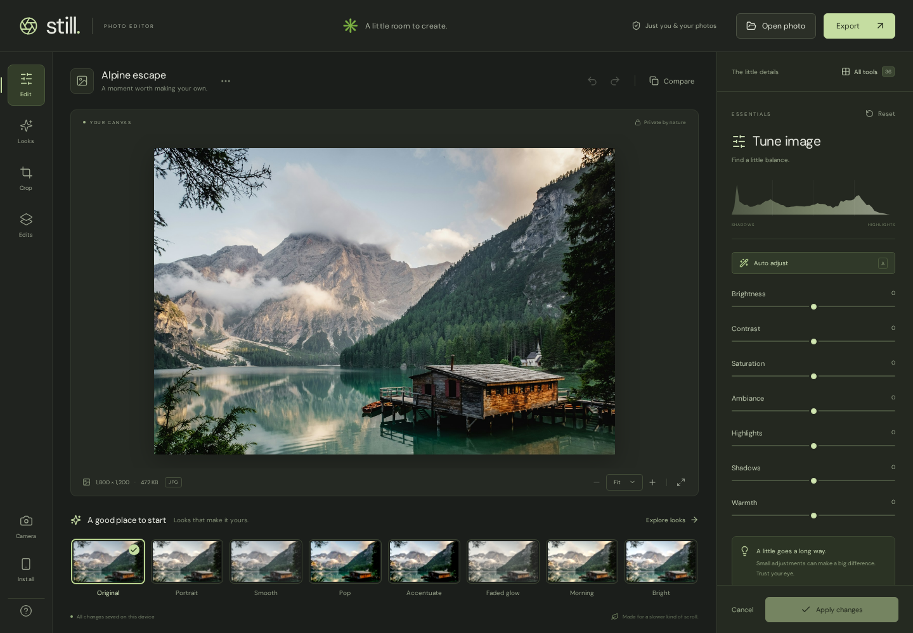

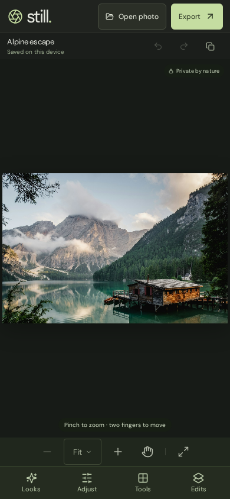

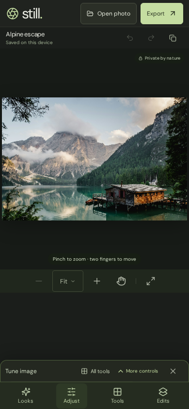

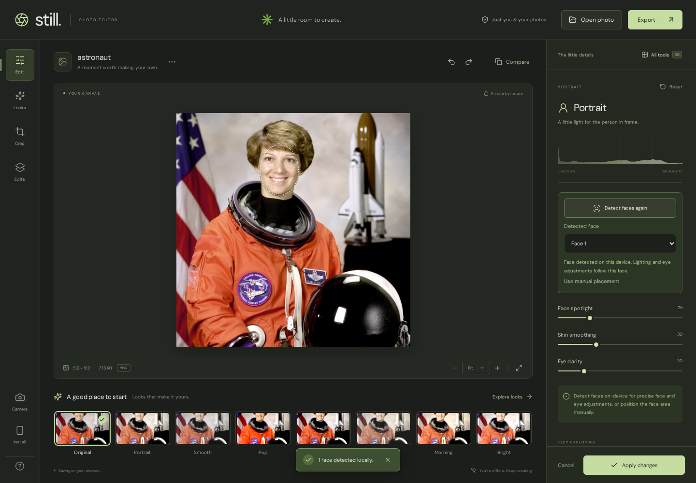

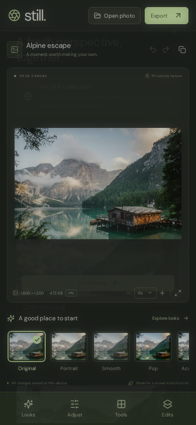

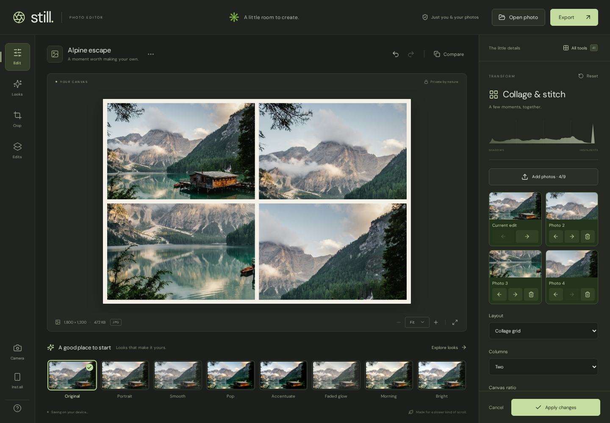

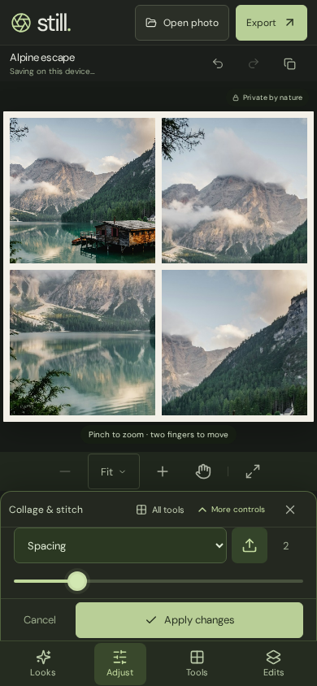

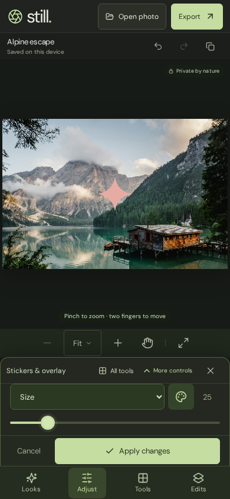

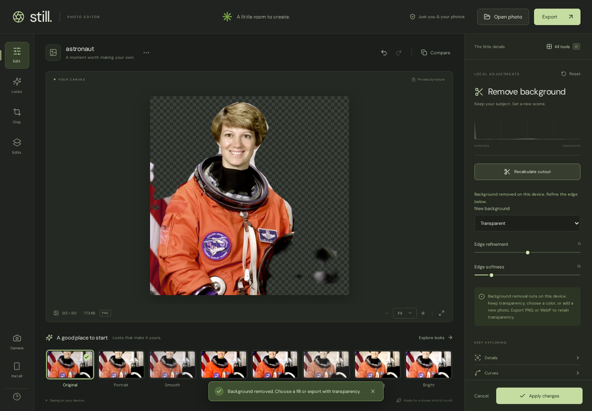

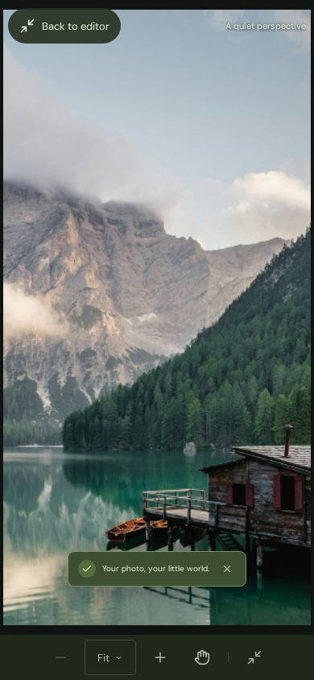

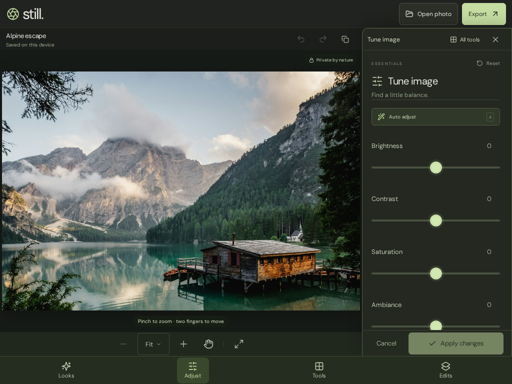
